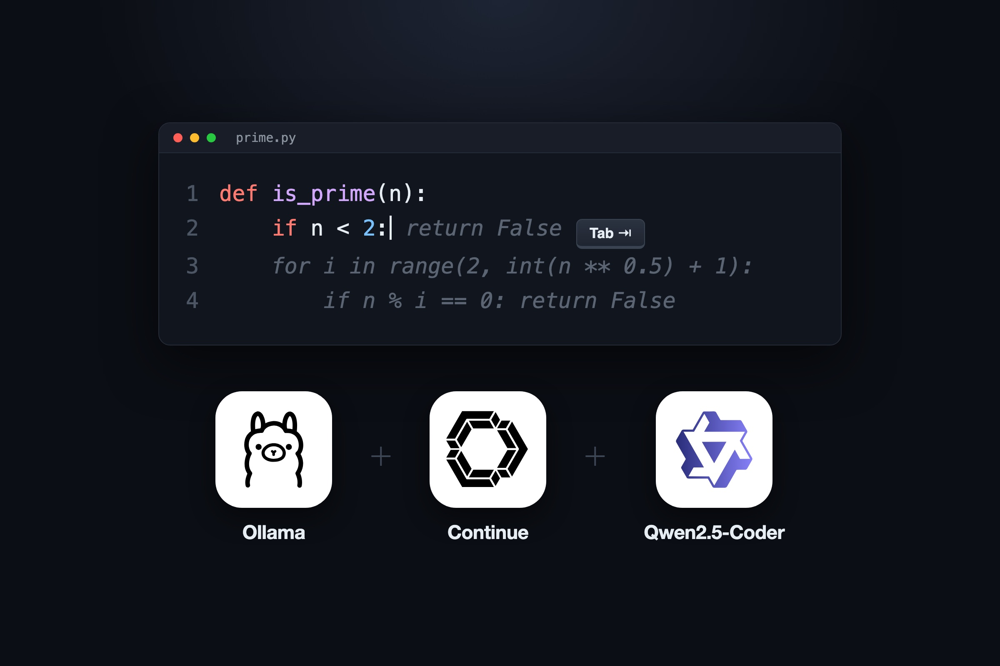
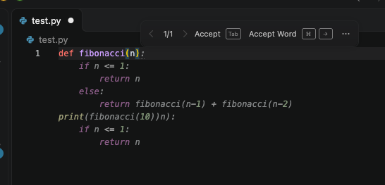
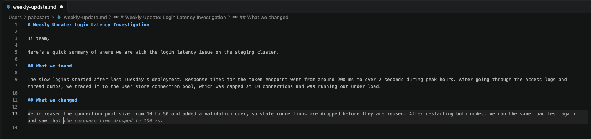
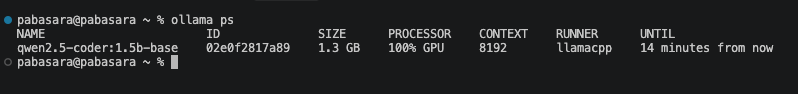

{: .centered}

**TL;DR:** After Supermaven stopped working and the free GitHub Copilot plan ran out in two days, I moved my tab autocomplete to a 1 GB model running on my own Mac. Suggestions arrive in about 400 ms, it uses 1.3 GB of memory, and it costs nothing.

In this post, I set up free, unlimited tab autocomplete in VS Code with Continue and Ollama, running Qwen2.5-Coder 1.5B locally. The end result works in code and in Markdown, answers in a median of 394 ms, and never sends a keystroke off the machine.

## Why Tab Autocomplete Matters to Me

Most of what I type in a day isn't code. It's case comments, internal docs, call notes, and email drafts, and I write nearly all of it in Markdown files inside VS Code.

**Tab autocomplete** is the grey "ghost text" an editor shows ahead of your cursor, which you accept by pressing Tab. In code, it finishes the loop you were obviously about to write. In prose, it finishes the sentence you were already halfway through, which matters more than it sounds when you write the same kind of update ten times a day.

It works a bit like a colleague who has heard your standup update so many times they can finish it for you. You still decide what goes in, but you stop typing the boring half.

## What I Tried Before

### Supermaven

**Supermaven** was a fast, cloud-based autocomplete extension, and for a long time it was exactly what I wanted. Then one day the status bar started flipping between "Connecting.." and "Disconnected" on every keystroke, and no suggestions came through.

The extension's debug log showed the agent connecting, authenticating, and then being dropped by the server:

```log
INFO  - Starting new edge connection
INFO  - UserStatus: Free Tier <no email>
ERROR - error reading from websocket: WebSocket protocol error: Connection reset without closing handshake
INFO  - websocket closed - shutting down EdgeConnection
```

The network was fine, and the WebSocket handshake to Supermaven's server succeeded from my machine. The real reason was on their side: [Supermaven was sunset in November 2025](https://supermaven.com/blog/sunsetting-supermaven), about a year after Anysphere, the company behind the Cursor editor, acquired it. VS Code users were pointed to Cursor.

### GitHub Copilot

**GitHub Copilot** is GitHub's AI assistant, with inline completions in VS Code. I used it for autocomplete in Markdown, and the suggestions were good.

The problem was the free plan's monthly completion cap. I filled it in two days. Paying for a subscription only for autocomplete didn't make sense, since I already use Claude Code for the heavier AI work.

I also looked at Cursor, but it's a separate editor built on VS Code, not an extension, and its free plan also limits Tab completions per month.

## The Setup

The stack has three parts:

- **Ollama** is an open-source tool that downloads language models and runs them locally, exposing them over a small HTTP API on `localhost:11434`.
- **Continue** is an open-source VS Code extension for AI-assisted editing. It can point at any model provider, including a local Ollama server.
- **Qwen2.5-Coder** is an open-weight family of coding models from Alibaba's Qwen team. I use the 1.5 billion parameter version.

I picked the *base* variant (`qwen2.5-coder:1.5b-base`) rather than the instruct one. Base models are trained for **fill-in-the-middle (FIM)**: they see the text before and after your cursor and predict what goes in the gap, which is exactly the job of autocomplete.

### Install Ollama and the model

On macOS, with Homebrew:

```bash
brew install ollama
brew services start ollama   # runs in the background and starts at login
ollama pull qwen2.5-coder:1.5b-base
```

A quick FIM request confirms the model works before any editor is involved:

```bash
curl -s localhost:11434/api/generate -d '{
  "model": "qwen2.5-coder:1.5b-base",
  "prompt": "def is_prime(n):\n    ",
  "suffix": "\n\nprint(is_prime(7))\n",
  "stream": false
}'
```

It returned a correct `is_prime` body at 143 tokens per second.

### Point Continue at it

After installing the Continue extension, the whole configuration is one file, `~/.continue/config.yaml`:

```yaml
name: Local
version: 1.0.0
schema: v1
models:
  - name: Qwen2.5-Coder 1.5B (local)
    provider: ollama
    model: qwen2.5-coder:1.5b-base
    apiBase: http://localhost:11434
    roles:
      - autocomplete
    defaultCompletionOptions:
      keepAlive: 900
```

The `autocomplete` role is the only one I gave it. Chat and agent work stay with Claude Code. I come back to `keepAlive` below.





## Results

I measured the first 45 real completion requests from VS Code using Ollama's own request log, on an M4 Pro MacBook with 24 GB of memory.

| Measure | Result |
|---|---|
| Fastest suggestion | 50 ms |
| Median | 394 ms |
| 90th percentile | 440 ms |
| Slowest (first request, model loading from disk) | 1.54 s |
| Generation speed (FIM test) | 143 tokens/s |

At under half a second, the suggestion is usually there by the time I pause. Supermaven was faster, but this is well inside the range where it feels like part of typing rather than waiting.

It works in Markdown as well as in code. The model is trained mostly on code, so I treat it as a sentence finisher, not a writer. It predicts likely text, and it has no idea what actually happened on a customer case, so a confident wrong version number or config key is always possible. Reading before pressing Tab is still my job.

## What It Costs Your Machine

| Resource | Usage |
|---|---|
| Model download | 986 MB |
| Memory while loaded | 1.1 GB with a 4K context, 1.3 GB with Continue's 8K context |
| Where it runs | 100% on the GPU (Apple Metal) |
| CPU | Negligible; short GPU bursts per suggestion |

On Apple Silicon the GPU shares memory with everything else, so that 1.3 GB comes out of the same 24 GB that my local WSO2 Identity Server nodes, MySQL, and Docker use. In practice, 1.3 GB is small enough that I don't notice it next to a two-node cluster. The 7B version of the same model gives noticeably better suggestions, but it needs several gigabytes more, which starts to compete with those servers on a 24 GB machine.

### The keep-alive surprise

Ollama unloads a model after 5 minutes without requests by default. That isn't what I saw. Running `ollama ps` showed the model staying loaded for about 30 more minutes, because Continue sends its own keep-alive value with every request and overrides Ollama's default.

I settled on 15 minutes with `keepAlive: 900` in the config above. That covers a coffee break without paying the 1 to 1.5 second reload, and still gives the memory back when I switch to something else.



When I need every bit of memory, for example during a load test, `ollama stop qwen2.5-coder:1.5b-base` frees it immediately.

## Other Things Worth Knowing

- ✅ **Nothing leaves the machine.** Ollama listens on `127.0.0.1` only, so customer names in my case notes stay on my laptop. This is the same reason I [sorted 70,000 photos with a local model](https://pabasara-mahindapala.github.io/writing/sorting-70000-photos-with-clip/) instead of a cloud API.
- ⚠️ **Turn off Copilot's inline suggestions** if you keep Copilot installed. Two tools offering ghost text will fight over the Tab key. I set `github.copilot.enable` to `false` for every language.
- ⚠️ **Continue sends telemetry by default.** I turned it off with `"continue.telemetryEnabled": false` in VS Code settings.
- **Next Edit is on by default.** It's a Continue feature that predicts your next edit elsewhere in the file, not only at the cursor. I left it on for now.
- **Mind the download on a slow connection.** I set this up on a phone hotspot running at about 100 KB/s, and the 1 GB model took roughly two hours. Plan the pull for a decent Wi-Fi connection.
- **macOS 27 ships an `fm` command** for Apple's on-device Foundation Model, and `fm serve` exposes it as a chat API. It's useful for chat, but it doesn't support fill-in-the-middle, so it isn't a fit for tab autocomplete.

## Conclusion

Losing Supermaven turned out to be a nudge toward something better suited to how I work. A 1 GB local model gives me unlimited tab autocomplete in code and Markdown, at under half a second per suggestion, for 1.3 GB of memory and no subscription.

The setup is three commands and one YAML file, and none of my notes leave the laptop.

What do you use tab autocomplete for outside of code? I'd love to hear in the comments.
