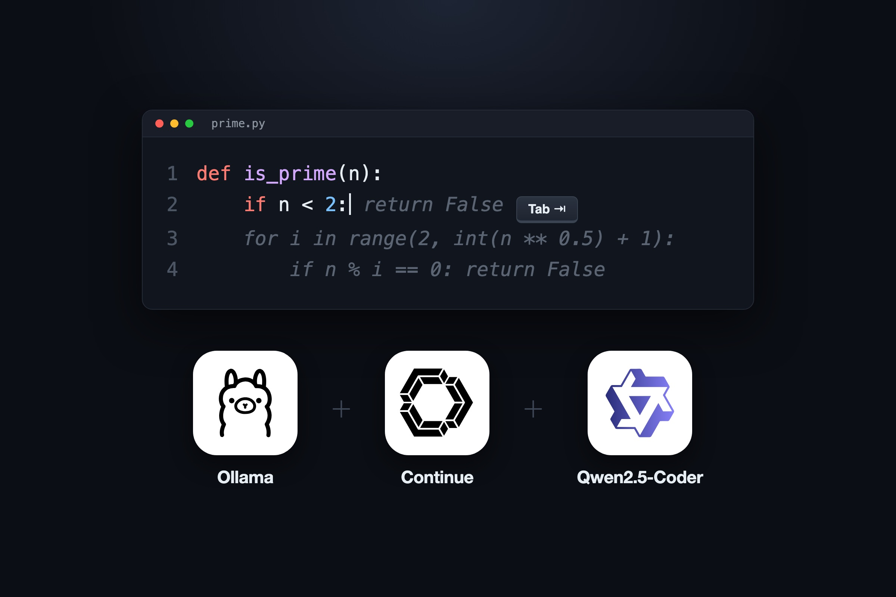
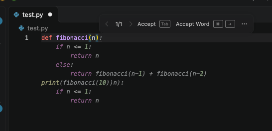
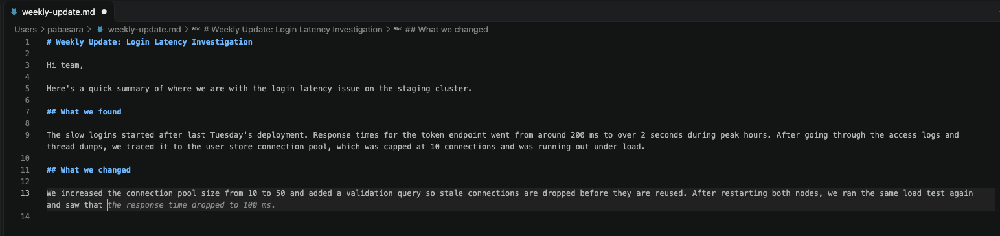
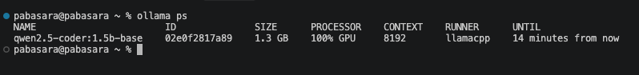

{: .centered}

I set up free, unlimited tab autocomplete in VS Code with Continue and Ollama, running Qwen2.5-Coder 1.5B locally.

You might wonder why tab autocomplete matters when there are coding tools like Claude Code or Codex that can write entire projects for you.

A fair amount of what I write in a day isn't only code. It's case comments, docs, notes, and emails that I don't want an AI tool to write entirely.

**Tab autocomplete** is the grey "ghost text" an editor like VS Code shows ahead of your cursor, which you accept by pressing **Tab** or **Cmd + Right Arrow**. In code, it can be the finishing to the loop you are writing. In text, it finishes the sentence you were already halfway through, which matters when you write the same kind of prose few times a day.

## The Setup

Only three ingredients:

- **Ollama** is an open-source tool that downloads language models and runs them locally, exposing them over a HTTP API on `localhost:11434`.
- **Continue** is an open-source VS Code extension for AI-assisted editing. It can point at any model provider, including a local Ollama server.
- **Qwen2.5-Coder** is an open-weight family of coding models from Alibaba's Qwen team.

I picked the *base* variant (`qwen2.5-coder:1.5b-base`) which is trained for **fill-in-the-middle (FIM)** (they see the text before and after your cursor and predict what goes in the gap).

### Install Ollama and the model

On macOS, with Homebrew:

```bash
brew install ollama
brew services start ollama   # runs in the background and starts at login
ollama pull qwen2.5-coder:1.5b-base
```

Run a quick FIM request to confirm the model works:

```bash
curl -s localhost:11434/api/generate -d '{
  "model": "qwen2.5-coder:1.5b-base",
  "prompt": "def is_prime(n):\n    ",
  "suffix": "\n\nprint(is_prime(7))\n",
  "stream": false
}'
```

It returned a correct `is_prime` body at 143 tokens per second.

### Point Continue at the model

After installing the Continue extension, update the file, `~/.continue/config.yaml`:

```yaml
name: Local
version: 1.0.0
schema: v1
models:
  - name: Qwen2.5-Coder 1.5B (local)
    provider: ollama
    model: qwen2.5-coder:1.5b-base
    apiBase: http://localhost:11434
    roles:
      - autocomplete
    defaultCompletionOptions:
      keepAlive: 900
```

The `autocomplete` role is the only one I needed. Chat and agent work can stay with Claude Code or Codex.





## Result

I measured the first 45 completion requests from VS Code using Ollama's request log (This is on an M4 Pro MacBook with 24 GB memory).

| Measure | Result |
|---|---|
| Fastest suggestion | 50 ms |
| Median | 394 ms |
| 90th percentile | 440 ms |
| Slowest (first request, model loading from disk) | 1.54 s |
| Generation speed (FIM test) | 143 tokens/s |

So the suggestion is there by the time you pause while typing.

It works in Markdown as well as in code. The model is trained mostly on code, so treat it as a sentence finisher, not a sophisticated writer.

## Cost

| Resource | Usage |
|---|---|
| Model size | 986 MB |
| Memory while loaded | 1.1 GB with a 4K context, 1.3 GB with Continue's 8K context |

On Apple Silicon the GPU shares memory with everything else, so that 1.3 GB comes out of the same 24 GB that everything else on the machine uses. In practice, 1.3 GB is small enough that I don't notice it. You can run a larger model if you have more memory.

### keep-alive

Ollama unloads a model after 5 minutes without requests by default. But Continue sends its own keep-alive value with every request and overrides Ollama's default.

I set it to 15 minutes with `keepAlive: 900` in the `config.yaml` shown above. So if I stop using it for a while, the model unloads and frees the memory. When I start typing again, it loads back in about 1.5 seconds.



Run `ollama stop qwen2.5-coder:1.5b-base` to unload the model and free the memory immediately.

That's it!

The biggest takeaway is that you can have a free, unlimited tab autocomplete in VS Code without anything leaving your machine, and it is fast enough to be useful.
